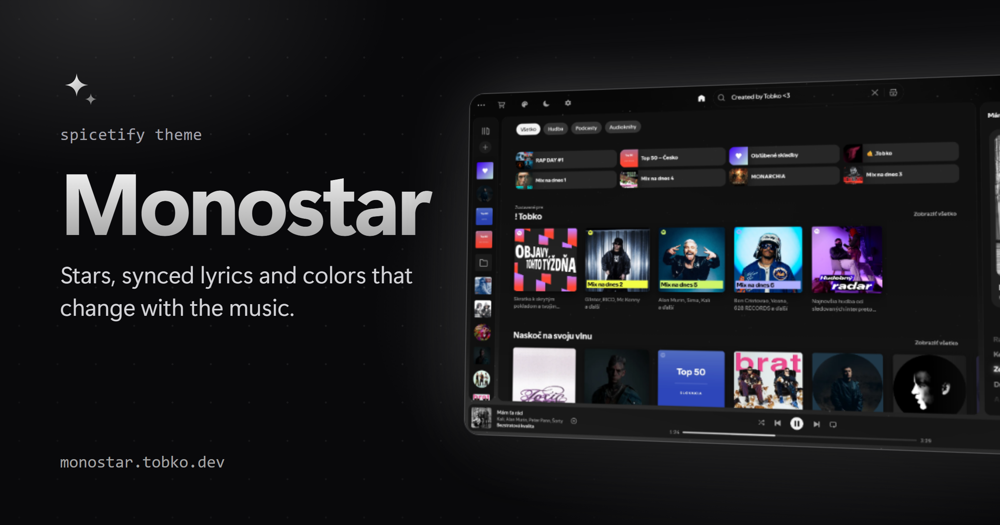
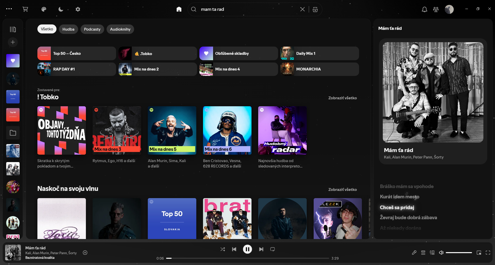
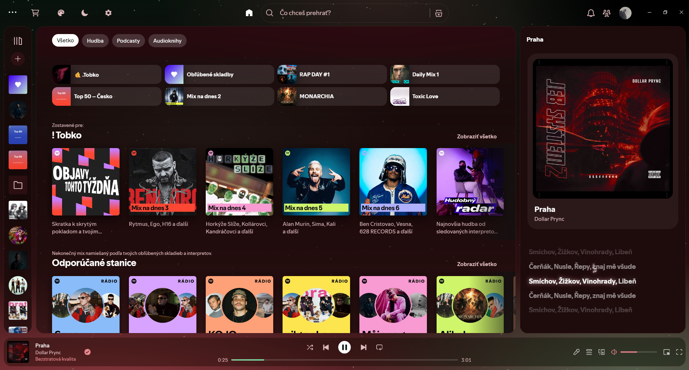
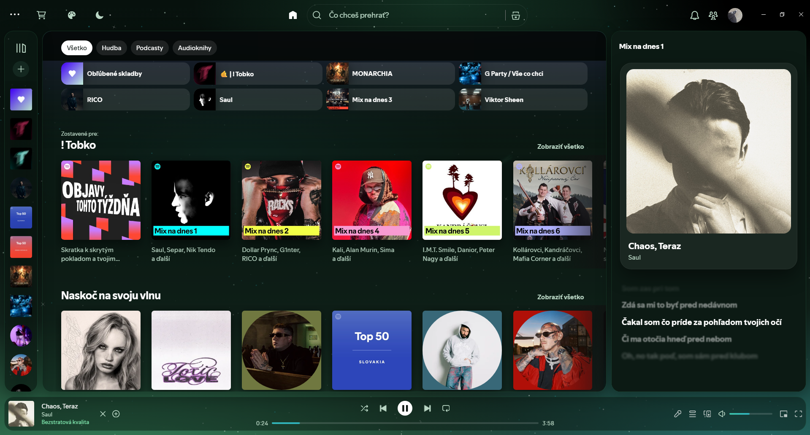
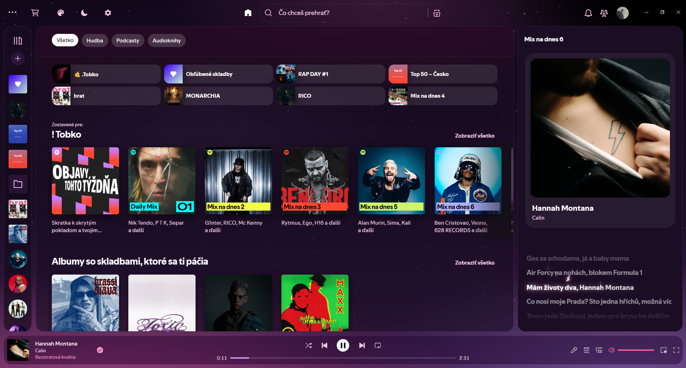
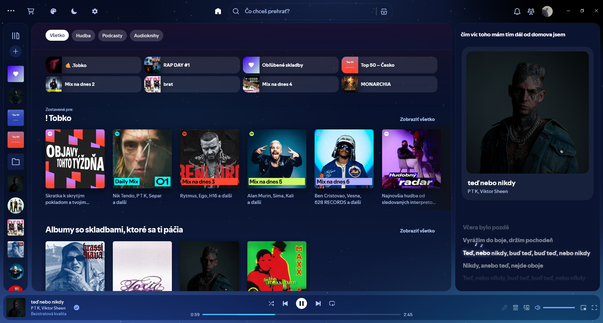
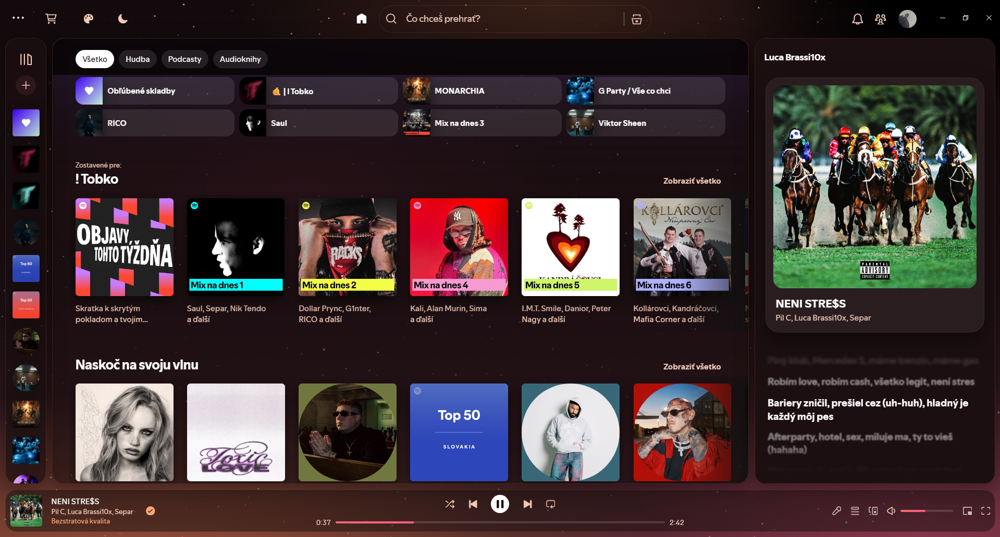
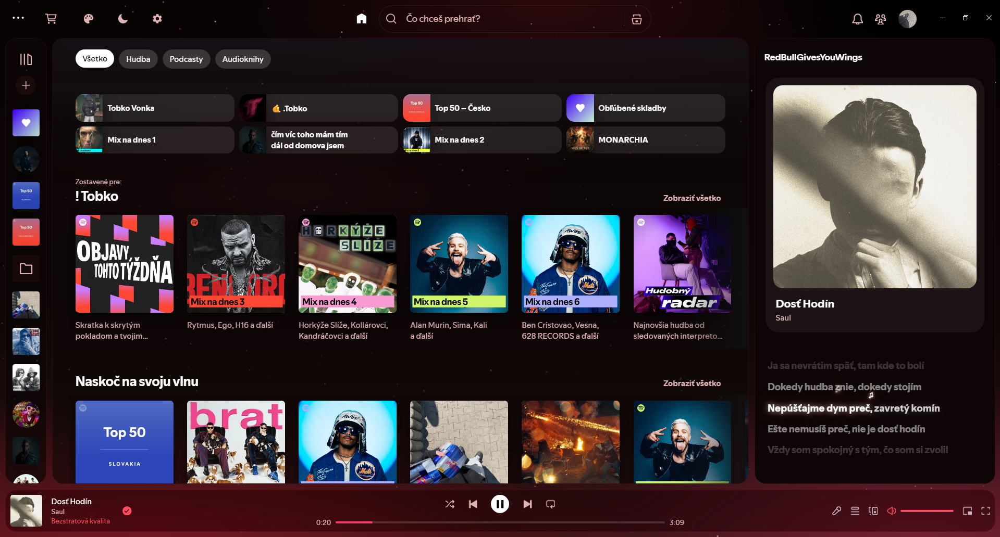

# Monostar



Spicetify theme with stars in the background, rounded everything, synced lyrics on the right and color schemes you can switch right inside Spotify.

**Version 1.2.0** · works on Spotify 1.3.11 · [monostar.tobko.dev](https://monostar.tobko.dev)

## Features

- Starry sky that pulses to the beat and gets brighter when the song gets louder
- Now playing card with synced lyrics on the right, lit up word by word
- Lyrics effects: glow, fill, music notes or embers
- Auto colors taken from the album cover, with a smooth fade between songs
- Seven color schemes, switchable from the palette button
- Sleep timer (15 min, 30 min, 1 hour or end of song) with a soft fade out
- Custom queue panel and a volume bar that changes color as it gets louder
- Glass menus and top bar
- Settings with a performance mode for weaker PCs
- Short intro on startup

## Settings

Click the gear in the top left corner.

- **Sky:** beat pulse, sky that follows the song
- **Lyrics:** word by word, blur around the current line
- **Word effect:** glow, fill, notes or embers
- **Other:** glass and blur, intro, performance mode

## Color schemes

Click the palette button in the top left corner and pick a color. It switches instantly and remembers your choice.

**Auto** picks two colors from the cover of the song that's playing and fades into them when the song changes.

| Clean | Auto |
|:---:|:---:|
|  |  |
| **Forest** | **Pink** |
|  |  |
| **Lavender** | **Midnight** |
|  |  |
| **Sunset** | **Crimson** |
|  |  |

## Installation

### Marketplace

1. Install [Spicetify](https://spicetify.app/) with the Marketplace
2. Open Marketplace → **Themes** and search for Monostar
3. Click **Install**

If you get *"Please set current_theme to 'marketplace'"*, run this first:

```
spicetify config current_theme marketplace
spicetify apply
```

### Manual

1. Install [Spicetify](https://spicetify.app/)
2. Click **Code → Download ZIP** on this page and unzip it
3. Copy the `Monostar` folder into the `Themes` folder (run `spicetify path userdata` to see where it is)
4. Run:
   ```
   spicetify config current_theme Monostar color_scheme Clean inject_theme_js 1
   spicetify apply
   ```

After a Spotify update, run `spicetify backup apply` to bring the theme back.

## Updating to 1.2.0

**Marketplace:** just restart Spotify, the new version loads by itself. If something looks off, open Marketplace → **Installed**, remove Monostar and install it again.

**Manual:**

1. Download the new ZIP (**Code → Download ZIP**)
2. Replace the old `Monostar` folder in your `Themes` folder with the new one
3. Run `spicetify apply`
