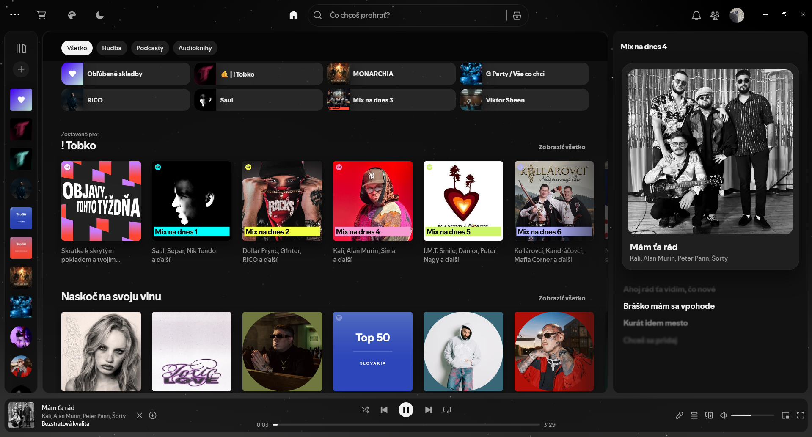
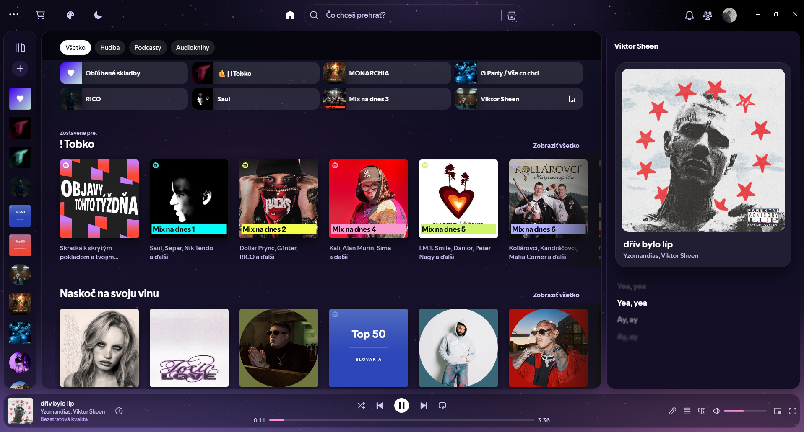

# Monostar



Spicetify theme with stars in the background, rounded everything, synced lyrics on the right and six color schemes you can switch right inside Spotify.

**Version 1.1.2**

## Features

- Starry sky that pulses to the beat of the song
- Now playing card with synced lyrics on the right
- Auto colors that follow the album cover
- Six color schemes, switchable from the palette button
- Sleep timer (15 min, 30 min, 1 hour or end of song) with a soft fade out
- Rounded, flat top bar and a short intro on startup

## Color schemes

Click the palette button in the top left corner and pick a color. It switches instantly and remembers your choice.

**Auto** picks the colors from the cover of the song that's playing.


| Clean | Forest |
|:---:|:---:|
|  |  |
| **Pink** | **Lavender** |
|  |  |
| **Midnight** | **Sunset** |
|  |  |

## Installation

### Marketplace

1. Install [Spicetify](https://spicetify.app/) with the Marketplace
2. Open Marketplace → **Themes**, scroll down, click **Load more** and find Monostar
3. Click **Install**

If you get *"Please set current_theme to 'marketplace'"*, run this first:

```
spicetify config current_theme marketplace
spicetify apply
```

### Manual

1. Install [Spicetify](https://spicetify.app/)
2. Click **Code → Download ZIP** on this page and unzip it
3. Copy the `Monostar` folder into the `Themes` folder (run `spicetify path userdata` to see where it is)
4. Run:
   ```
   spicetify config current_theme Monostar color_scheme Clean inject_theme_js 1
   spicetify apply
   ```

After a Spotify update, run `spicetify backup apply` to bring the theme back.

## Updating from 1.1.1 to 1.1.2

**Marketplace:** just restart Spotify, the new version loads by itself. If something looks off, open Marketplace → **Installed**, remove Monostar and install it again.

**Manual:**

1. Download the new ZIP (**Code → Download ZIP**)
2. Replace the old `Monostar` folder in your `Themes` folder with the new one
3. Run `spicetify apply`
